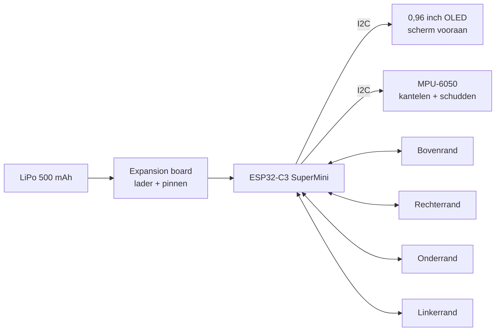
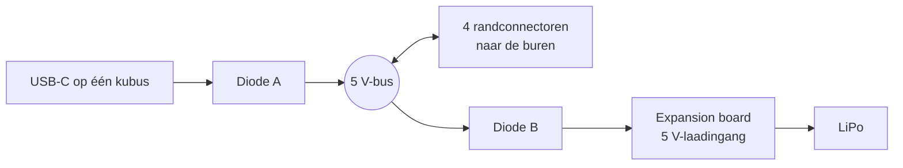
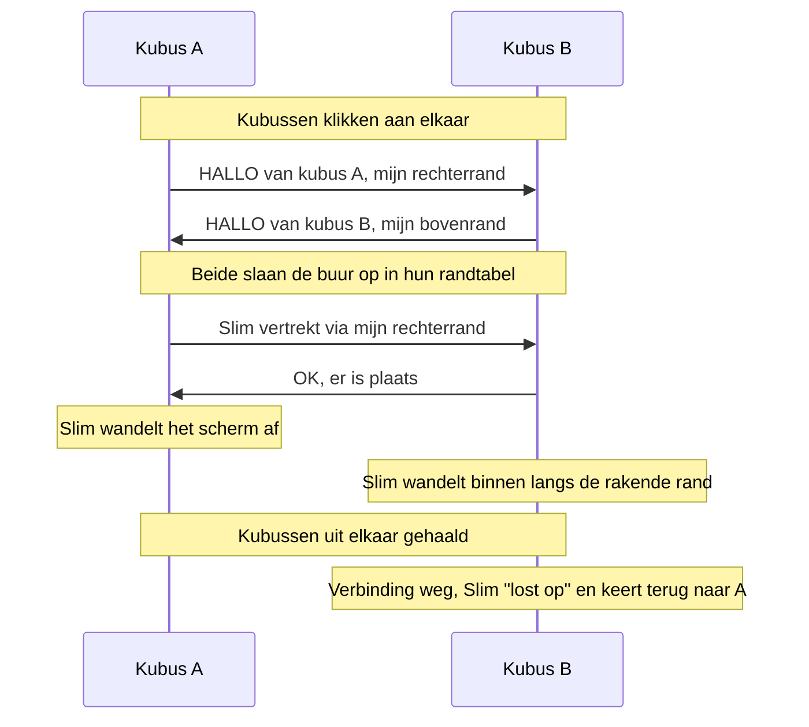
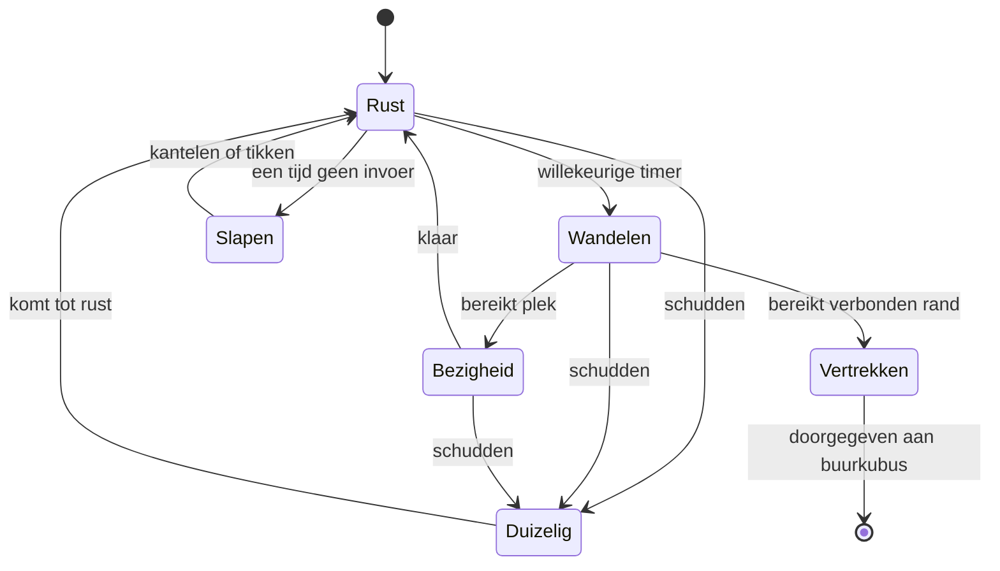

# Cubelings: het idee

Cubelings zijn kleine bureaukubusjes, elk met een eigen streepjesmannetje als bewoner. Kantel of schud een kubus en zijn Cubeling reageert. Klik kubussen aan elkaar op eender welke rand en de figuurtjes kunnen van de ene kubus naar de andere wandelen, bij elkaar op bezoek gaan en over je hele bureau zwerven.

## Inspiratie

**Cube World** van Radica (midden jaren 2000, later Mattel): kleine kubusjes met een lcd-scherm en een streepjesmannetje erin. Elk figuurtje had zijn eigen bezigheid, je kon de kubus schudden of kantelen om het te plagen, en kubussen klikten met magneten aan elkaar zodat de figuurtjes van de ene naar de andere konden springen.

Er bestaat geen opensource-namaak van. De projecten die het dichtst in de buurt komen:

- [npjg/radica-cube-world-hack](https://github.com/npjg/radica-cube-world-hack): reverse-engineering van hoe de originele kubussen communiceren
- [Adafruit Tiny LED WiFi Cube](https://learn.adafruit.com/tiny-led-wifi-cube/overview): ESP32 + versnellingsmeter in een kubus
- Tamagotchi-klonen op Arduino (bv. Cassagotchi): een wezentje dat op een piepklein OLED-scherm leeft

Cubelings vult dat gat: een speeltje in Cube World-stijl, gebouwd met goedkope onderdelen uit de winkel.

## Ontwerpdoelen

- **Eén scherm, vooraan**, zoals de originelen
- **Goedkoop genoeg om er veel te maken**: ongeveer €37–43 per kubus
- **Enkel onderdelen uit de winkel**: geen eigen printplaten of zelfgemaakte connectoren
- **Elke rand past op elke rand**, met de schermen naar voren
- **Geprogrammeerd in Python** (MicroPython)
- **Een hele rij opladen met één USB-kabel**

## Wat zit er in een kubus



Volledige onderdelenlijst met links en prijzen: [partlist.md](partlist.md)

## Kubussen verbinden

### Het probleem

Magnetische pogo-connectoren komen per paar: een **stekker** (verende pinnen) en een **contrastekker** (vlakke contacten). Een stekker past alleen op een contrastekker. Als elke kubus op elke andere kubus moet passen, op eender welke rand, welke helft zet je dan waar?

### De oplossing: de wijzerzin-regel

Elke rand krijgt **één stekker en één contrastekker, naast elkaar**. Kijk vanaf de voorkant naar de kubus en ga met de klok mee rond de randen: op elke rand zit de **stekker op de helft die je eerst tegenkomt**, de contrastekker op de tweede helft.

```
          [S]         [C]
       +---------------------+
       |                     |
   [C] |                     | [S]
       |    +-----------+    |
       |    |   OLED    |    |
       |    +-----------+    |
   [S] |                     | [C]
       |                     |
       +---------------------+
          [C]         [S]

   S = stekker (pinnen)    C = contrastekker (contacten)
```

Als twee kubussen elkaar raken, lopen hun wijzerzin-richtingen tegengesteld langs de gedeelde rand, zoals twee tandwielen die in elkaar grijpen. Zo komt **een stekker altijd op een contrastekker terecht**, welke randen elkaar ook raken en hoe een kubus ook gedraaid is (0°, 90°, 180°, 270°). De enige regel: beide schermen kijken naar voren.

Elk connectorpaar wordt gesplitst: de stekkerhelft gaat op één rand, de contrastekkerhelft op de volgende rand in wijzerzin. Dat zijn **4 paren per kubus** voor 4 randen.

De magneten in de connectoren stoten elkaar af als je ze verkeerd om houdt, dus je kunt kubussen niet fout aan elkaar zetten.

### Bedrading per rand

Elke connector heeft 3 pinnen:

| Helft | Pin 1 | Pin 2 | Pin 3 |
|-------|-------|-------|-------|
| Stekker | GND | 5 V (gedeeld) | TX (zenden) |
| Contrastekker | GND | 5 V (gedeeld) | RX (ontvangen) |

De TX van de ene kubus komt altijd op de RX van de andere terecht, in beide richtingen tegelijk. Zo kunnen beide kubussen tegelijk praten zonder botsingen. De kubus weet ook precies **langs welke rand** een bericht binnenkwam, want elke rand heeft zijn eigen RX-pin.

GPIO-budget: 4 randen × (TX + RX) = 8 pinnen, plus 2 voor I2C = 10 van de 13 GPIO's van de SuperMini. De 5 V- en GND-pinnen gebruiken geen GPIO's.

### De hele rij opladen

De 5 V-pin op elke rand is verbonden met één gedeelde **5 V-bus** binnen in de kubus. Steek één kubus in USB-C en de 5 V loopt via de connectoren naar elke kubus in de rij, zodat ze allemaal tegelijk opladen.



Twee diodes per kubus houden de stroom in de juiste richting:

- **Diode A** laat de eigen USB-C van de kubus de bus voeden, maar voorkomt dat de bus terugduwt in de USB-poort.
- **Diode B** laat de bus de lader voeden, maar voorkomt dat een kubus op batterij zijn buren probeert te voeden.

Regels:

- De bus gaat alleen naar de **laadingang**, nooit rechtstreeks naar een batterij. Batterijen die verschillend opgeladen zijn en rechtstreeks verbonden worden, duwen grote stromen in elkaar.
- Het verbruik is laag: elk expansion board laadt met max. 100 mA, dus 5 kubussen is maar 0,5 A, ruim binnen wat USB en de connectoren (2 A) aankunnen.
- Controleer op de eerste kubus hoe de 5 V- en USB-pinnen van het expansion board verbonden zijn, voor je de bus bedraadt.

### Gedraaide kubussen

Een kubus die zijwaarts verbonden is, heeft ook een zijwaarts scherm. De MPU-6050 weet waar onder is, dus de software draait het beeld mee en de Cubeling blijft altijd rechtop.

## Hoe een Cubeling van kubus wisselt



Elke kubus houdt een kleine tabel bij van zijn buren, bv. `{rechts: "A", boven: "C"}`. Met drie of meer kubussen kunnen figuurtjes langs de hele rij springen. Net als bij de originelen kan een kubus een maximum aantal bezoekers hebben (Cube World liet er vier toe).

## Gedrag van het figuurtje



- **Rust / wandelen / bezigheid / slapen** vormen de persoonlijkheidslus, met willekeurige timers ertussen
- **Kantelen** laat de Cubeling die kant op wandelen of glijden
- **Schudden** onderbreekt alles met een duizelige of omvallende animatie
- Elke kubus krijgt een **eigen figuurtje met een eigen bezigheid**, zoals in de originele reeks

## Bouwplan

1. **Eén kubus op het bureau:** ESP32 + OLED. Teken een streepjesmannetje en laat het heen en weer wandelen.
2. **Versnellingsmeter erbij:** kantelen om te wandelen, schudden om duizelig te worden, scherm automatisch draaien.
3. **Persoonlijkheidslus:** toestandsmachine met rust, wandelen, bezigheid, slapen.
4. **Tweede kubus + connectoren:** HALLO-handdruk via één rand, daarna alle vier de randen.
5. **Figuurtje doorgeven:** van het ene scherm af wandelen, het andere op wandelen.
6. **Behuizing:** 3D-geprinte kubus met exacte connectorsleuven en een venster voor het scherm.
7. **Batterij + gedeeld laden:** zonder kabel werken, batterij-indicator toevoegen, 5 V-bus bedraden zodat een rij oplaadt via één kabel.
8. **Meer kubussen, meer figuurtjes.**

## Bekeken opties (en waarom niet)

| Optie | Waarom niet (voorlopig) |
|-------|-------------------------|
| Adafruit QT Py ESP32-S3 + Adafruit-onderdelen | Werkt prima, maar ~€55–70 per kubus |
| Zes 8×8 led-matrices (Adafruit-kubus) | Het origineel had enkel een scherm vooraan; één OLED ziet er beter uit en is goedkoper |
| Draadloos (ESP-NOW) + Hall-sensoren | Contactloos en goedkoop, maar kubussen moeten via timing raden wie naast wie ligt |
| Infrarood-led + ontvanger per zijde | Genderloos, maar meer onderdelen per zijde en geen stroom delen mogelijk |
| Zelfgemaakte genderloze connectoren (pogo-pinnen + contacten + magneten) | Goedkoopst per zijde, maar vraagt eigen knutselwerk |
| Concentrische contacten / magneten als contacten | Genderloos en draaibestendig, maar zelfbouw |
| Onderdelen van AliExpress | Goedkoopst, maar traag, en het doel is enkel Europese winkels |

## Open vragen

- Exacte grootte van de kubus: ~45 mm? Hangt af van hoe de connectoren, batterij en printplaten passen.
- Passen de 3-pins connectoren van BerryBase met twee per rand?
- Welke figuurtjes en bezigheden? (De originelen hadden onder meer een mannetje met een stok, een hond, een touw…)
- Software-serial op 4 randen tegelijk: bit-banged UART of polling met een eenvoudig protocol?
