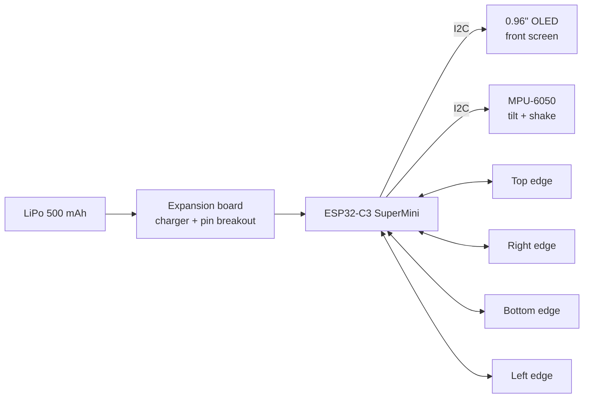
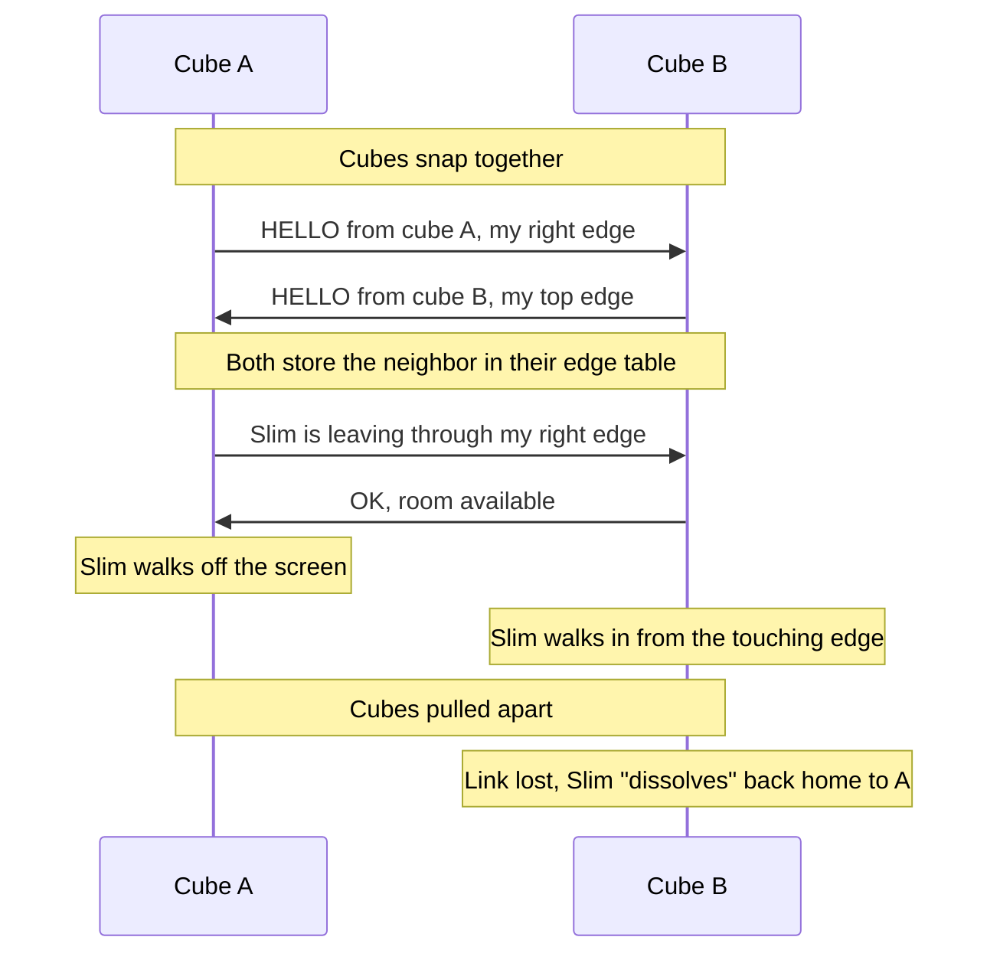
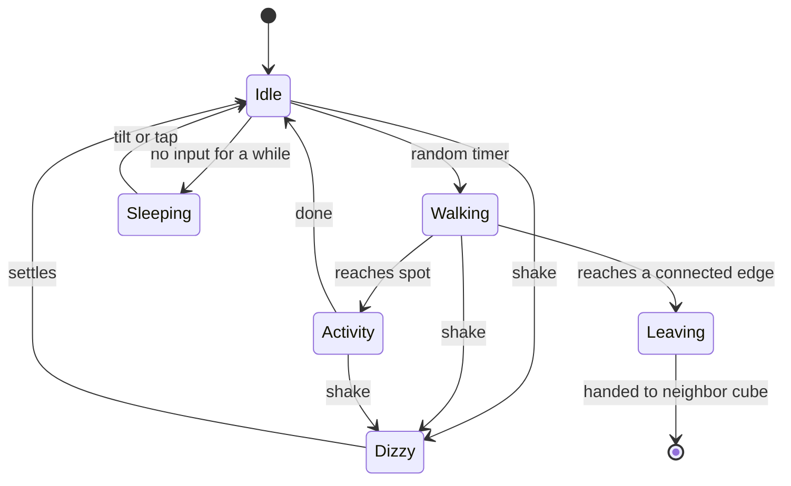

# Cubelings: the idea

Cubelings are little desk cubes, each home to a stick-figure resident. Tilt or shake a cube and its Cubeling reacts. Snap cubes together on any edge and the characters can walk from one cube into the next, visit each other, and wander across the whole desk.

## Inspiration

Radica's **Cube World** (mid-2000s, later Mattel): small cubes with an LCD screen and a stick figure inside. Each character had its own activity, you could shake or tilt the cube to mess with it, and cubes connected with magnets so characters could jump between them.

There's no open-source recreation of it. The closest projects are:

- [npjg/radica-cube-world-hack](https://github.com/npjg/radica-cube-world-hack): reverse-engineering the original cubes' communication
- [Adafruit Tiny LED WiFi Cube](https://learn.adafruit.com/tiny-led-wifi-cube/overview): ESP32 + accelerometer in a cube
- Arduino Tamagotchi clones (e.g. Cassagotchi): a creature living on a tiny OLED

Cubelings fills that gap: a Cube World-style toy built from cheap, store-bought parts.

## Design goals

- **One screen, on the front**, like the originals
- **Cheap enough to make many**: around €35–40 per cube
- **Store-bought parts only**: no custom PCBs or DIY connectors
- **Any edge connects to any edge**, with screens facing forward
- **Programmed in Python** (MicroPython)

## What's inside a cube



Full parts list with links and prices: [partlist.md](partlist.md)

## Connecting cubes

### The problem

Magnetic pogo connectors come as a pair: a **plug** (spring pins) and a **socket** (flat pads). Plug only fits socket. So if every cube should connect to every other cube, on any edge, which half goes where?

### The solution: the clockwise rule

Every edge gets **one plug and one socket, side by side**. Looking at the cube from the front, go around the edges clockwise: on each edge, the **plug sits on the half you reach first**, the socket on the half you reach second.

```
          [P]         [S]
       +---------------------+
       |                     |
   [S] |                     | [P]
       |    +-----------+    |
       |    |   OLED    |    |
       |    +-----------+    |
   [P] |                     | [S]
       |                     |
       +---------------------+
          [S]         [P]

   P = plug (pins)    S = socket (pads)
```

When two cubes touch, their clockwise directions run opposite along the shared edge, like two gears meshing. So **a plug always lands on a socket**, whichever edges meet and however a cube is turned (0°, 90°, 180°, 270°). The only rule: both screens face forward.

Each connector pair gets split: the plug half goes on one edge, the socket half on the next edge clockwise. That's **4 pairs per cube** for 4 edges.

The magnets in the connectors repel when reversed, so cubes can't be joined the wrong way.

### Wiring per edge

Each connector only needs 2 pins:

| Half | Pin 1 | Pin 2 |
|------|-------|-------|
| Plug | GND | TX (send) |
| Socket | GND | RX (receive) |

One cube's TX always lands on the other cube's RX, in both directions at once, so both cubes can talk simultaneously without collisions. The cube also knows exactly **which edge** a message came in on, because each edge has its own RX pin.

GPIO budget: 4 edges × (TX + RX) = 8 pins, plus 2 for I2C = 10 of the SuperMini's 13 GPIOs.

### Turned cubes

A cube that's connected sideways has its screen sideways too. The MPU-6050 knows which way is down, so the software rotates the picture and the Cubeling always stays upright.

## How a Cubeling moves between cubes



Each cube keeps a small table of its neighbors, e.g. `{right: "A", top: "C"}`. With three or more cubes, characters can hop along the chain. Like the originals, a cube could have a maximum number of visitors (Cube World allowed four).

## Character behavior



- **Idle / walking / activity / sleeping** make up the personality loop, with random timers in between
- **Tilt** makes the Cubeling walk or slide that way
- **Shake** interrupts everything with a dizzy or falling-over animation
- Every cube gets its **own character with its own activity**, like the original series

## Build plan

1. **One cube on the desk:** ESP32 + OLED. Draw a stick figure, make it walk back and forth.
2. **Add the accelerometer:** tilt to walk, shake to get dizzy, auto-rotate the screen.
3. **Personality loop:** state machine with idle, walk, activity, sleep.
4. **Second cube + connectors:** HELLO handshake over one edge, then all four edges.
5. **Character transfer:** walk off one screen, walk onto the other.
6. **Shell:** 3D-printed cube with exact connector slots and a window for the screen.
7. **Battery:** run untethered, add a battery indicator.
8. **More cubes, more characters.**

## Options considered (and why not)

| Option | Why not (for now) |
|--------|-------------------|
| Adafruit QT Py ESP32-S3 + Adafruit parts | Works great, but ~€55–70 per cube |
| Six 8×8 LED matrices (Adafruit cube) | Original only had a front screen; one OLED looks better and is cheaper |
| Wireless (ESP-NOW) + Hall sensors | Contactless and cheap, but cubes must guess who's next to whom by timing |
| Infrared LED + receiver per face | Genderless, but more parts per face and can't share power |
| DIY genderless connectors (pogo pins + pads + magnets) | Cheapest per face, but needs custom building |
| Concentric contacts / magnets as contacts | Genderless and rotation-proof, but DIY |
| AliExpress parts | Cheapest, but slow, and the goal is EU shops only |

## Open questions

- Exact cube size: ~45 mm? Depends on how the connectors, battery and boards fit.
- Do the BerryBase 2-pin connectors fit two per edge?
- Should connectors also share power (3rd pin) so a chain can run off one USB cable?
- Which characters and activities? (The originals had things like a guy with a stick, a dog, a rope…)
- Software serial on 4 edges at once: bit-banged UART or polling with a simple protocol?
