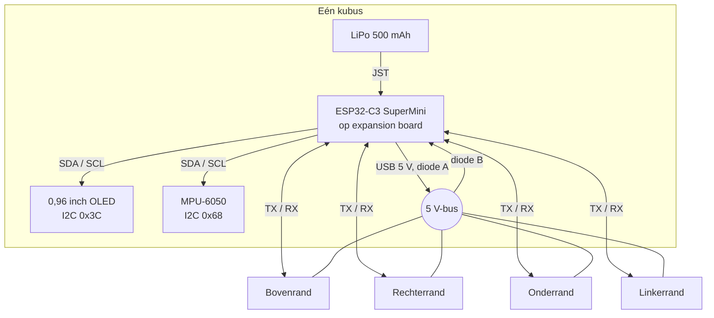
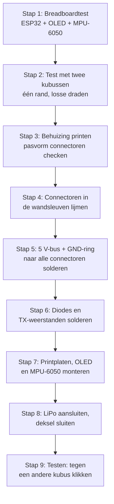

# Bouwen en bedraden

Hoe je één Cubeling-kubus bedraadt en in elkaar zet. Voor de onderdelen, zie [partlist.md](partlist.md). Voor het idee achter de connectoren en het opladen, zie [Ideas.md](Ideas.md).

> Dit is een eerste plan. Test alles op een breadboard met twee kubussen voor je alles in een behuizing soldeert.

## 1. Overzicht



De OLED en de MPU-6050 delen één I2C-bus. Ze hebben verschillende adressen (0x3C en 0x68), dus dat botst niet.

## 2. Pintoewijzing (ESP32-C3 SuperMini)

| GPIO | Gebruik | Opmerkingen |
|------|---------|-------------|
| 8 | I2C SDA | OLED + MPU-6050. Ook de ingebouwde led, geen probleem |
| 9 | I2C SCL | OLED + MPU-6050. Ook de BOOT-knop, geen probleem |
| 0 | TX bovenrand | via weerstand van 1 kΩ |
| 1 | RX bovenrand | |
| 3 | TX rechterrand | via weerstand van 1 kΩ |
| 4 | RX rechterrand | |
| 5 | TX onderrand | via weerstand van 1 kΩ |
| 6 | RX onderrand | |
| 7 | TX linkerrand | via weerstand van 1 kΩ |
| 10 | RX linkerrand | |
| 2 | vrij | Strapping-pin, vrij laten of voorzichtig gebruiken |
| 20, 21 | vrij | Seriële debug (UART0) |
| 3V3 | VCC van OLED en MPU-6050 | |
| GND | Massa van alles | |

**Waarom de weerstanden van 1 kΩ:** als de ene kubus aan staat en zijn buur uit, zou de TX-lijn stroom in de RX-pin van de slapende kubus duwen. Een weerstand van 1 kΩ in serie op elke TX beperkt dat tot een onschadelijk niveau. 4 per kubus.

## 3. Bedrading per onderdeel

### OLED en MPU-6050

| ESP32-C3 | OLED | MPU-6050 |
|----------|------|----------|
| 3V3 | VCC | VCC |
| GND | GND | GND |
| GPIO 8 | SDA | SDA |
| GPIO 9 | SCL | SCL |

Simpel gezegd: VCC aan VCC, GND aan GND, SDA aan SDA, SCL aan SCL, allemaal parallel.

### Eén rand (herhaal voor alle 4)

Elke rand heeft een stekkerhelft en een contrastekkerhelft naast elkaar (wijzerzin-regel, zie Ideas.md). Beide zijn 3-pins:

```
           STEKKER-helft          CONTRASTEKKER-helft
          +-----------+             +-----------+
  pin 1   |   GND     |---- GND ----|   GND     |  pin 1
  pin 2   |   5 V     |---- BUS ----|   5 V     |  pin 2
  pin 3   |   TX      |             |   RX      |  pin 3
          +-----+-----+             +-----+-----+
                |                         |
             [1 kΩ]                       |
                |                         |
       GPIO (TX van de rand)      GPIO (RX van de rand)
```

- Pin 1 en pin 2 van **alle 8 connectorhelften** gaan naar dezelfde GND en dezelfde 5 V-bus.
- Pin 3 van de stekker gaat via een weerstand van 1 kΩ naar de TX-GPIO van die rand.
- Pin 3 van de contrastekker gaat rechtstreeks naar de RX-GPIO van die rand.
- Houd de pinvolgorde op elke connector identiek, zodat pin 1 altijd op pin 1 valt.

### 5 V-bus en opladen

```
  USB-C 5 V (5V-pin van de SuperMini)
        |
     [diode A]   ->|-   streepje naar de bus
        |
  ======+=========== 5 V-BUS ============+====+====+====
        |                                |    |    |
     [diode B]   ->|-   streepje naar   boven rechts onder links
        |            de lader           (pin 2 van elke connector)
        |
  5 V- / laadingang van het expansion board
        |
     LiPo (JST)
```

- **Diode A:** streepje naar de bus. Laat de USB van deze kubus de rij voeden.
- **Diode B:** streepje naar de lader. Laat de rij deze kubus opladen.
- De bus gaat **nooit** rechtstreeks naar de batterij.
- Gebruik Schottky-diodes (1N58xx, SSxx). Gewone 1N400x-diodes hebben te veel spanningsverlies.
- Test eerst: brandt de laadled niet op een kubus die via de rij oplaadt, laat dan diode A weg.

## 4. De kubus bouwen

### Vooraanzicht

Ongeveer 45 × 45 mm. Twee connectoren per rand, op een kwart en op driekwart van de rand.

```
        11 mm       34 mm
          v           v
         [S]         [C]
       +---------------------+
       |                     |
  [C]  |   +-------------+   |  [S]   < 11 mm
       |   |             |   |
       |   |    OLED-    |   |
       |   |   venster   |   |
       |   |             |   |
  [S]  |   +-------------+   |  [C]   < 34 mm
       |                     |
       +---------------------+
         [C]         [S]

   S = stekkerhelft    C = contrastekkerhelft
   Gemeten in wijzerzin vanaf de beginhoek van elke rand
```

**De positie moet op elke kubus exact hetzelfde zijn**, anders liggen de connectoren niet op één lijn. Zet de posities één keer in het 3D-model en print elke behuizing uit hetzelfde bestand.

### Zijdoorsnede

```
  voorkant                               achterkant
    |                                        |
    v                                        v
  +---+------+-----------------+-----------+---+
  |   |      |                 |           |   |
  | W | OLED |  SuperMini op   |   LiPo    | D |
  | a |      |  expansion board| 500 mAh   | e |
  | n |      |                 |           | k |
  | d |      |   MPU-6050      |           | s |
  |   |      |   (plat gelijmd)|           | e |
  +---+------+-----------------+-----------+---+
         ^                                   ^
    schermvenster                     afneembaar deksel
                                      (toegang tot USB-C)
```

- **Voorwand** met een uitgesneden venster voor de OLED, de OLED erachter gelijmd of geklemd.
- **Midden:** de SuperMini op zijn expansion board, vastgezet met M2-schroefjes op afstandsbusjes.
- **MPU-6050** plat en recht in de kubus gemonteerd, zodat "onder" in de software overeenkomt met echt onder.
- **Achteraan:** de LiPo, met een afneembaar deksel dat toegang geeft tot de USB-C-poort.
- **Randen:** de connectorhelften zitten in sleuven in de wanden, gelijk met het buitenoppervlak. Liggen ze zelfs 0,5 mm verzonken, dan raken de pinnen elkaar niet.

### Montagevolgorde



### Tips

- Soldeer de GND- en 5 V-draden als een **ring** rond de binnenkant van de behuizing, en tak van daaruit af naar elke connector. Dat is netter dan 8 aparte draden naar het bord.
- Label elke connectorhelft met een stift (B-S, B-C, R-S…) voor je ze lijmt, zodat je er geen verwisselt.
- Controleer elke connector met een multimeter voor je de kubus sluit: pin 1 naar GND, pin 2 naar de bus, pin 3 naar de juiste GPIO.
- Gebruik dunne siliconendraad, die buigt makkelijk in een kleine behuizing.
